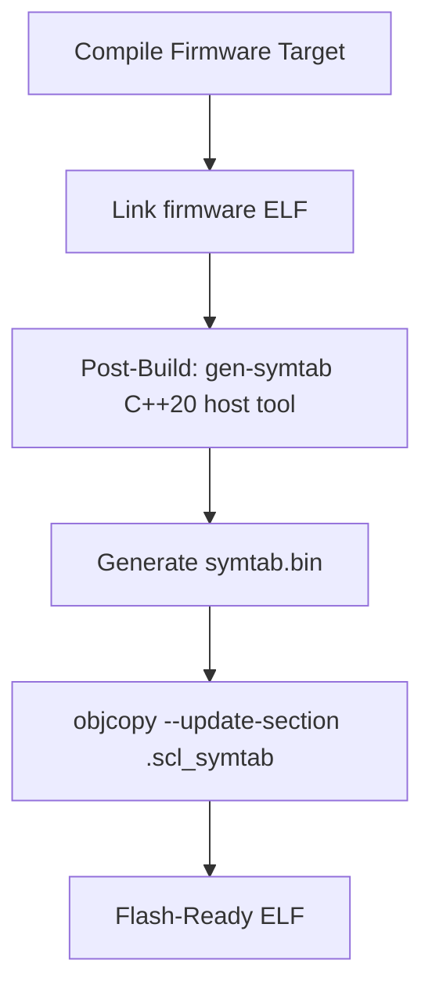

# Dynamic Symbol Resolution & Clean Decoupling in XIP Dynamic-Newlib

This document details the architectural changes made to eliminate the hardcoded `addr_of()` symbol mapping inside the Execute-in-Place (XIP) newlib dynamic loader ([adapter.cpp](file:///home/dan/Documents/shared-loaders-weact_agy/src/xip/dynamic-newlib/adapter.cpp)) and transition the XIP test suite to a generic, link-time embedded symbol table.

---

## 1. The Problem: Hardcoded Symbol Tables

The dynamic loader variant `scl::xip-dynamic-newlib` enables executing the `.text` segment of dynamic libraries directly in internal Flash, copying only the `.data` and `.bss` segments to RAM.

Previously, resolving symbols that a loaded library imports from the host firmware (such as `printf`, `malloc`, `sinf`, and C++ runtime support) relied on a hardcoded fallback lookup table in `src/xip/dynamic-newlib/adapter.cpp`:
```cpp
void* addr_of(const char* name) {
    if (std::strcmp(name, "printf") == 0)    return THUMB(std::printf);
    if (std::strcmp(name, "puts") == 0)      return THUMB(std::puts);
    // ... ~40 strcmp fallback mappings ...
}
```
This design was unacceptable for a general-purpose library:
1. **Lack of Generality**: Any change to standard library usage or addition of custom host exports required manually modifying the library's adapter source.
2. **Compile-Time Leakage**: Weakly defined testing fixtures (`AA`, `BB`, `s1`, `f`, `w`, etc.) were hardcoded directly in the core library, leaking testing details into production code.

---

## 2. The Solution: Dynamic Link-Time Symbol Embedding

We ported the XIP dynamic-newlib loader to the same architecture used by the non-XIP dynamic-newlib loader: **link-time symbol table extraction and flash embedding**.



### Key Changes Introduced

1. **Clean Decoupling in the Loader**:
   * Removed `addr_of()` and all hardcoded stubs from [adapter.cpp](file:///home/dan/Documents/shared-loaders-weact_agy/src/xip/dynamic-newlib/adapter.cpp).
   * Declared a global `firmware::link_context g_ctx` inside the loader adapter.
   * Exposed `xip::newlib::set_symtab()` in [adapter.hpp](file:///home/dan/Documents/shared-loaders-weact_agy/include/xip/dynamic-newlib/adapter.hpp) to allow the host application to register its symbol table at boot.
   * Updated `dlopen()` and `xip_cross_lookup()` to query `g_ctx` dynamically.

2. **Heuristic Symbol Pruning**:
   * Linking against newlib and stdc++ pulls in thousands of global/weak compiler internals. Generating a table for all of them yielded over **87 KB**, which exceeded the STM32F411's 256 KB program Flash boundary (as Flash sectors 6-7 are reserved for the flat filesystem).
   * Refactored [gen-symtab.py](file:///home/dan/Documents/shared-loaders-weact_agy/test/tools/gen-symtab.py) to prune compiler and library internal symbols (those starting with `_` or `__`) unless they belong to an essential whitelist of C++ ABI, reentrancy, and exception handling functions:
     * `_impure_ptr`, `_Znw` (new), `_Zdl` (delete), `__cxa` (exceptions), `__errno`, `__exidx`, `__gnu_Unwind`, and `__*frame_info`.
   * This successfully reduced the final symbol table size to only **7.5 KB** (299 symbols).

3. **Linker Script & Target Setup**:
   * Added the `.scl_symtab` section reservation to [sections-flatfs-hosted.ld](file:///home/dan/Documents/shared-loaders-weact_agy/test-xip/test-xip-dynamic-newlib/test1/src/sections-flatfs-hosted.ld).
   * Integrated the compilation of `symtab-blob.c` placeholder and the post-build `gen-symtab.py` update command into [CMakeLists.txt](file:///home/dan/Documents/shared-loaders-weact_agy/test-xip/test-xip-dynamic-newlib/test1/CMakeLists.txt), specifying `SCL_SYMTAB_BLOB_KB=12`.
   * Configured the newlib target to skip compilation when building in a freestanding environment (`SCL_HOSTED=OFF`).

4. **Robust Startup Resolution**:
   * Updated [main.cpp](file:///home/dan/Documents/shared-loaders-weact_agy/test-xip/test-xip-dynamic-newlib/test1/src/main.cpp) to initialize the symbols at boot:
     ```cpp
     std::size_t n_syms = 0;
     if (auto* flash = flash_symtab(n_syms)) {
         xip::newlib::set_symtab(flash, n_syms);
     } else {
         n_syms = load_symtab(); // Semihosting ELF reader fallback
         if (n_syms > 0) xip::newlib::set_symtab(g_symtab, n_syms);
     }
     ```

---

## 3. Results & Benefits

* **Generic Library**: The `scl::xip-dynamic-newlib` loader is now fully general-purpose and handles arbitrary custom exports from the main application without code changes.
* **Tight Flash Integration**: The compressed symbol table fits easily within the 256 KB sector cap.
* **Runtime Efficiency**: The flash table operates with zero RAM usage (compared to keeping the 77 KB string table in RAM for the semihosting fallback) and requires 0 boot I/O overhead.
