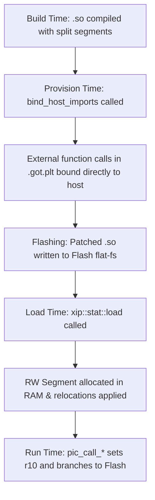

# Static-XIP Loader Architecture & Reference Guide

This document describes the design, compilation options, memory footprint, and runtime behavior of the **Static-XIP Loader** implemented under `test-xip/test-static`.

---

## 1. Overview

The **Static-XIP (Execution In Place)** loader is a lightweight, bare-metal loader designed for ARM Cortex-M microcontrollers. It allows shared libraries (`.so` files) to be loaded dynamically from a file system (such as the Flash-based Flat-FS) and executed. 

### Why "Static"?
Unlike the standard dynamic loader (`scl::dynamic-nolib`), the static loader has **no runtime dynamic-linker service** (no `dlopen`/`dlsym` daemon, no runtime lazy binding, and no routing trampolines). 
- All symbols are resolved and patched **eagerly at load time or provision time**.
- Imports are resolved against main's own dynamic symbol table via
  `fw::link_context::from_self()` (main is `-pie -Wl,-E`) — no hand-maintained host
  table and no `-u` link anchors. (Earlier revisions used an explicit `g_host[]`
  registry; see `../../doc/xip-memory-analysis.md` §10.4 for the migration and the one
  residual linkage anchor it needs.)

### Why "XIP"?
**Execution In Place (XIP)** means that the code segment executes directly from Flash memory. It eliminates the need to copy the library's large code segment into RAM, conserving precious SRAM.

---

## 2. Memory Layout during Execution

Under the Static-XIP model, every loaded library is split into two distinct segments based on their mutability:

1. **R-X Segment (Read-Only & Executable)**:
   - Remains in **Flash** at its flashed location in the Flat-FS.
   - Code is executed directly from Flash (Execution in Place).
2. **RW Segment (Read-Write)**:
   - Copied to **RAM** at load time.
   - Houses the Global Offset Table (GOT), initialized data (`.data`), and uninitialized data (`.bss`).

### Section Allocation Table

| Section | Location | RAM / Flash | Description |
|---|---|---|---|
| **`.text`** | Flash (`0x08xxxxxx`) | **Flash** | Executable CPU instructions. |
| **`.rodata`** | Flash (`0x08xxxxxx`) | **Flash** | Constants and string literals. |
| **`.plt`** | Flash (`0x08xxxxxx`) | **Flash** | Procedure Linkage Table (relayed branches). |
| **`.got.plt`** | Flash (`0x08xxxxxx`) | **Flash** | PLT jump destinations (patched at provision time). |
| **`.got`** | RAM (`0x20xxxxxx`) | **RAM** | Global Offset Table (patched at load time). |
| **`.data`** | RAM (`0x20xxxxxx`) | **RAM** | Initialized global/static variables. |
| **`.bss`** | RAM (`0x20xxxxxx`) | **RAM** | Zero-initialized global/static variables. |
| **`.ARM.exidx`** | Flash (`0x08xxxxxx`) | **Flash** | C++ exception handling table. |

### Footprint & RAM Benefits
- **Traditional Dynamic Loading**: Copies the entire `.so` file (including code) into RAM. A 10KB library consumes 10KB of RAM.
- **Static-XIP Loading**: Only copies the GOT and mutable data (`.data` / `.bss`) to RAM. Typically, **80% to 95% of the RAM footprint is saved**.

---

## 3. Compiler & Build Options

To achieve XIP split execution, both the shared libraries and the host application must be compiled with specific flags.

### 3.1 For Shared Libraries (`.so`)
To compile XIP-eligible libraries, use the following flags (defined in [build-fixtures.sh](../fixtures-src/build-fixtures.sh) and [build-xip-libs.sh](../fixtures-src/build-xip-libs.sh)):

- **Target Architecture**:
  `-mcpu=cortex-m4 -mthumb -mfloat-abi=hard -mfpu=fpv4-sp-d16`
  Matches the host CPU floating-point and instruction set.
- **Position Independence**:
  `-fpic -msingle-pic-base -mpic-register=r10 -mno-pic-data-is-text-relative`
  - `-fpic`: Generates position-independent code.
  - `-msingle-pic-base -mpic-register=r10`: Uses register `r10` as the base address of the RAM-resident GOT.
  - `-mno-pic-data-is-text-relative`: Prevents the compiler from assuming the offset between text (Flash) and data (RAM) is constant.
- **Linking**:
  `-shared -nostartfiles -Wl,-E -Wl,-Bsymbolic -T xip-split.ld`
  - `-Wl,-Bsymbolic`: Binds internal function calls locally (direct branch), bypassing the PLT for intra-library calls.
  - `-T xip-split.ld`: Employs a custom linker script to split the output into two load segments (R-X and RW) where virtual addresses align with file offsets.

### 3.2 For the Host Application (`main`)
The host application links so its symbols are resolvable by the loader (defined in [CMakeLists.txt](CMakeLists.txt)):

- **Linking**:
  `-pie LINKER:-E LINKER:--gc-sections`
  - `-pie`: Generates a Position Independent Executable.
  - `LINKER:-E` (or `-Wl,-E`): exports **every global the host defines** into `.dynsym`, the table the loader (`link_context::from_self()`) queries. **No `-u` flag is needed** for host-defined symbols — `-E` keeps them and `--gc-sections` treats exported symbols as referenced.
- **Borrowed library symbols**: symbols the libraries need but the host never calls itself (`printf`, `sinf`, `operator new` = `_Znwj`, the C++ EH runtime) live in `libc.a`/`libsupc++.a` and are pulled from an archive only when referenced. A single `[[gnu::used, gnu::retain]]` anchor array in `main.cpp` references exactly that set — **replacing the former pile of `-Wl,-u,<sym>` flags** — so `-E` can export them. (See `../../doc/xip-memory-analysis.md` §10.4.)

---

## 4. Execution & Binding Pipeline

The Static-XIP architecture implements a **two-phase binding pipeline**:

### Phase 1: Provision Time (Before Flashing)
Because the Procedure Linkage Table (PLT) resides in Flash, its jump targets in `.got.plt` cannot be modified at runtime. 
1. The host application reads the raw `.so` file via semihosting into a temporary RAM buffer.
2. It executes [xip::stat::bind_host_imports](src/xip-static-loader.hpp).
3. The function parses the ELF headers, locates `.rel.plt` jump slots, and patches the target addresses of host functions (e.g. `printf`) directly into the `.got.plt` slots of the RAM buffer.
4. Because the host application is compiled as `r10`-free (does not use a GOT base register), the library can branch directly into the host code without an intermediate `r10`-swapping trampoline.
5. The patched `.so` file is written to the Flash-resident Flat-FS.

### Phase 2: Load Time (Runtime)
When the application starts, it loads the library from Flash:
1. It calls [xip::stat::load](src/xip-static-loader.hpp).
2. The loader allocates a memory block for the RW segment in RAM using `fw::image_arena`.
3. It copies `.data` from Flash to RAM and zeroes `.bss`.
4. It iterates over `.rel.dyn` and applies relocations (such as variables like `fm_var` or data imports) using [xip::apply_rel_xip](../../src/xip/relocate.cpp).
5. It runs any static constructors (`.init_array`) using `pic_call_void`, setting `r10` to the allocated GOT base.

### Phase 3: Function Invocations
To invoke a function exported by the library:
1. Resolve the symbol using [xip::stat::resolve](src/xip-static-loader.hpp) (returns a pointer in Flash or RAM).
2. Enter the library using the `pic_call_*` assembly wrappers, which pre-load the `r10` register with the module's `got_base` before executing the branch.

---

## 5. Architectural Limitations

While the Static-XIP model is highly efficient, it introduces a few limitations:

1. **No Cross-Library Calls**:
   - Because the static loader does not use a routing trampoline to swap `r10` dynamically, a function in `libA.so` cannot directly call a function in `libB.so`. 
   - Doing so would execute `libB.so`'s code using `libA.so`'s GOT base, leading to memory corruption or crashes. All external imports must be resolved to the host application (`main`).
2. **C++ Exception Propagation**:
   - Throwing a C++ exception that must traverse a library-to-host or library-to-library boundary is unsupported due to the differences in section mapping and `.ARM.exidx` unwinding limits. Internal exceptions caught within the same library are supported.
